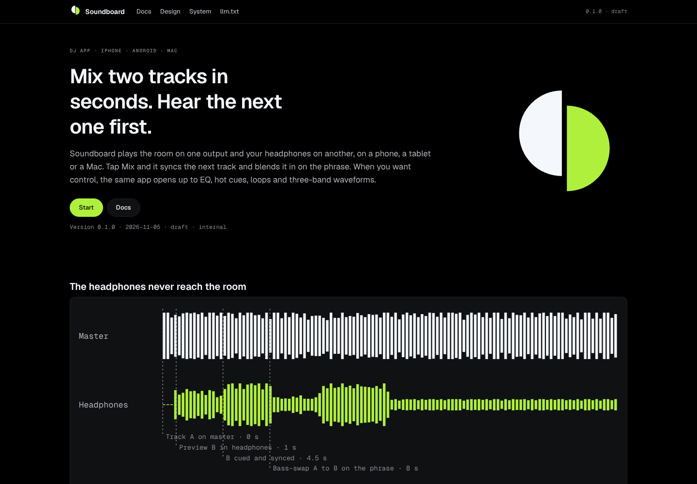

# Soundboard

A DJ app for iPhone, Android and Mac with a real headphone cue, for anyone who wants to mix two tracks in seconds and keep going to a full set.



## Start

Requirements: macOS with Xcode 15 or later for the apps; CMake 3.16+ and a C++17 compiler for the
engine; Node 20+ and Python 3 for the checks and site. Android needs the Android SDK and NDK.

```bash
make setup      # checks the toolchain, generates the Xcode project if XcodeGen is installed
make validate   # every check and test
make dev        # opens platforms/apple/Soundboard.xcodeproj (macOS) or serves the docs site
```

Run the **Soundboard** scheme on a device or the Mac. The **Routing Lab** scheme verifies master
and cue routing by ear. Full guide: [docs/guides/local-development.md](docs/guides/local-development.md).

## Layout

```
Soundboard/
├── README.md         this page
├── AGENTS.md         for an agent: what to read, run, and never do
├── ROADMAP.md        what is next, by version
├── CHANGELOG.md      what changed, by version
├── LICENSE           all rights reserved; third-party licences listed
├── SECURITY.md       how to report a vulnerability
├── CONTRIBUTORS.md   who, and how to join
├── station.json      the manifest
├── .station/         status and jobs for this repository
├── .github/          CI, issue and PR templates
├── .archives/        removed files kept with a reason; audit reports
├── docs/             overview, architecture, guides, decisions (ADRs), research
├── deploy/           Dockerfile and compose for the engine build and the docs site
├── public/           the docs site, design kit, system graph and llm.txt (generated)
├── index.html        the resource page: run, read, see, get the source (generated)
├── Makefile          setup · dev · build · test · validate · up · down · site · dist
├── tools/            site generator, checks, screenshots, dist
├── engine/           Soundboard Engine: C++17 core, C API, tests, routing prototype
├── platforms/apple/  Swift packages, Soundboard and Routing Lab apps (iOS, macOS)
├── platforms/android/ Oboe host, Kotlin route planning, Routing Lab app
├── design/tokens/    Obsidian tokens in OKLCH and their generator
├── brand/            Split mark, Pulse, app icons
└── Package.swift     the Swift package at the root (engine + Apple targets)
```

## Links

| | |
|---|---|
| Overview | [docs/README.md](docs/README.md) |
| Architecture | [docs/architecture.md](docs/architecture.md) |
| Platform audio research | [docs/research/platform-audio.md](docs/research/platform-audio.md) |
| Product | [docs/product.md](docs/product.md) |
| Design system | [docs/design/appearance.md](docs/design/appearance.md) · [public/design/DESIGN.md](public/design/DESIGN.md) |
| Brand | [docs/brand.md](docs/brand.md) |
| Guides | [docs/guides/](docs/guides/) |
| Decisions | [docs/decisions/](docs/decisions/) |
| Docs site | [public/index.html](public/index.html) (open from disk, or `make site-serve`) |
| Agents | [AGENTS.md](AGENTS.md) · [public/llm.txt](public/llm.txt) |
| API, SDK, CLI, MCP | None in 0.1.0. The engine's C API is [engine/include/soundboard/sbe.h](engine/include/soundboard/sbe.h) |
| Roadmap · Changelog | [ROADMAP.md](ROADMAP.md) · [CHANGELOG.md](CHANGELOG.md) |
| Security | [SECURITY.md](SECURITY.md) |

## Sponsor

None is recorded: this is an internal repository.
